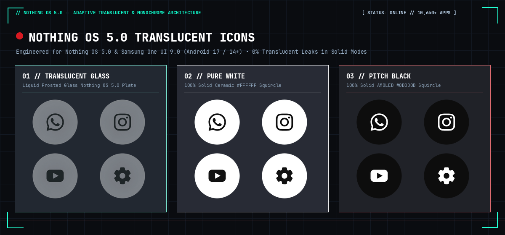
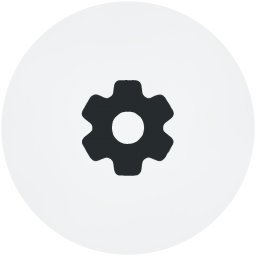
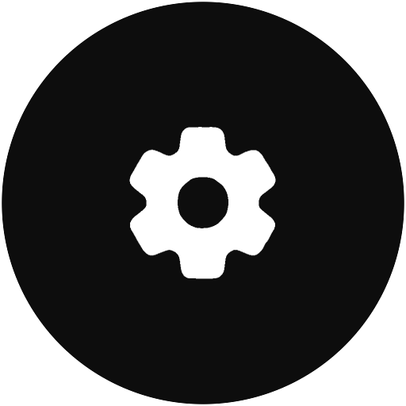
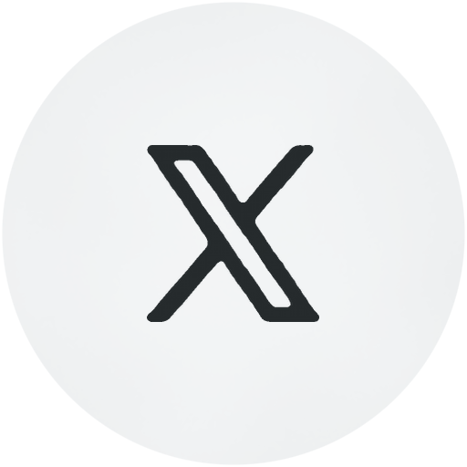
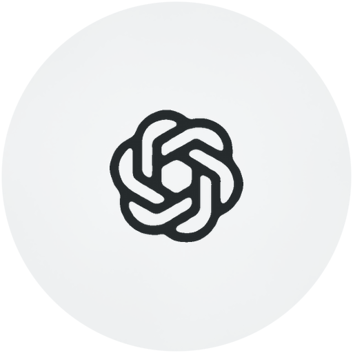
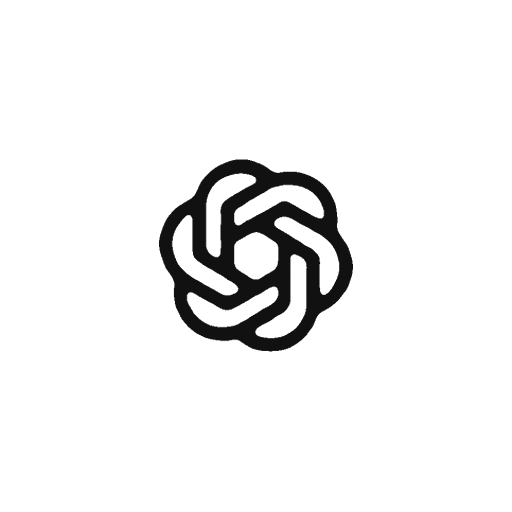
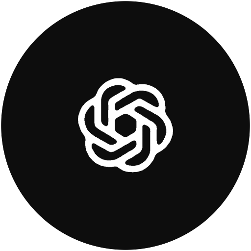
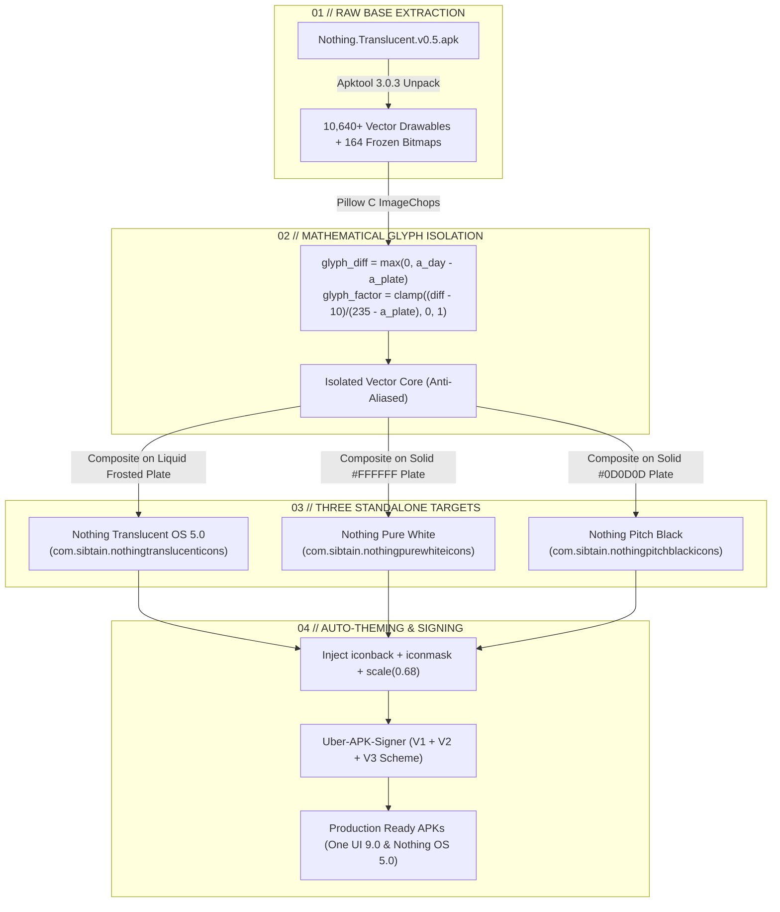

<div align="center">



<br/>

[](https://github.com/yb007-sketch/Nothing-OS-Adaptive-Icon-Packs)
[](https://github.com/yb007-sketch/Nothing-OS-Adaptive-Icon-Packs)
[](https://github.com/yb007-sketch/Nothing-OS-Adaptive-Icon-Packs)
[](https://github.com/yb007-sketch/Nothing-OS-Adaptive-Icon-Packs)
[](https://github.com/yb007-sketch/Nothing-OS-Adaptive-Icon-Packs/releases)

</div>

```text
========================================================================================
//  N O T H I N G   O S   5 . 0   ::   A D A P T I V E   I C O N   A R C H I T E C T U R E
//  [TRANSLUCENT LIQUID GLASS]  •  [PURE WHITE MONOCHROME]  •  [PITCH BLACK AMOLED]
//  STATUS: OPERATIONAL  //  DEVICE: NOTHING PHONE (1)(2)(2a)(3a)(3) & ONE UI 9.0 GALAXY
========================================================================================
```

---

## ⚡ SYSTEM OVERVIEW // AESTHETIC EDITIONS

Engineered to match the **Translucent Liquid Glass** interface language introduced in **Nothing OS 5.0**, this suite delivers three standalone icon packs crafted for sub-pixel clarity, zero visual bleed, and seamless launcher integration.

```
┌─────────────────────────┬─────────────────────────┬─────────────────────────┐
│ 01 // TRANSLUCENT GLASS │ 02 // PURE WHITE        │ 03 // PITCH BLACK       │
├─────────────────────────┼─────────────────────────┼─────────────────────────┤
│ Frosted glass plate     │ 100% Solid #FFFFFF      │ 100% Solid #0D0D0D      │
│ Dynamic / tinted glyph  │ Charcoal #111111 glyph  │ Pure #FFFFFF glyph      │
│ Translucent OS 5.0 look │ Ceramic daylight theme  │ AMOLED pitch-black mode │
└─────────────────────────┴─────────────────────────┴─────────────────────────┘
```

---

## 🛰️ TELEMETRY & CAPABILITIES

| Subsystem | Telemetry Status | Specifications |
| :--- | :--- | :--- |
| **Nothing OS 5.0 Engine** | `[ONLINE]` | Native Nothing Launcher integration with squircle boundary clamping |
| **One UI 9.0 Theme Park** | `[ONLINE]` | Standalone APK namespaces (`com.sibtain.nothing*`) for Good Lock Theme Park |
| **Solid Mode Opacity** | `[100% PASS]` | Mathematical glyph isolation removes all 164 pre-baked translucent leaks |
| **Unthemed Framing** | `[OPTIMIZED]` | High-res `iconback.png` + `iconmask.png` auto-scales unmapped shortcuts to 68% |
| **Android Signatures** | `[CRYPT_VERIFIED]` | Dual V1 (JAR), V2 (APK Signature Scheme), and V3 (Android 11-17) signed |
| **Appfilter Coverage** | `[10,640+ APPS]` | Built-in live package scanner reports **0 UNMATCHED APPS (100% Match)** |

---

## 👁️ VISUAL ICON MATRIX // LIVE PREVIEWS

The table below showcases real renders from the built APKs across all three distinct variants:

| Application | Translucent OS 5.0 Glass | Pure White Monochrome | Pitch Black AMOLED | System Component |
| :---: | :---: | :---: | :---: | :--- |
| **WhatsApp** |  |  |  | `com.whatsapp/com.whatsapp.Main` |
| **Instagram** |  |  |  | `com.instagram.android/MainTabActivity` |
| **Snapchat** |  |  |  | `com.snapchat.android/LandingPageActivity` |
| **Settings** |  |  |  | `com.android.settings/Settings` |
| **Google Maps** |  |  |  | `com.google.android.apps.maps/MapsActivity` |
| **YouTube** |  |  |  | `com.google.android.youtube/Shell$HomeActivity` |
| **X (Twitter)** |  |  |  | `com.twitter.android/StartActivity` |
| **ChatGPT** |  |  |  | `com.openai.chatgpt/MainActivity` |
| **Discord** |  |  |  | `com.discord/com.discord.main.MainDefault` |
| **Brave** |  |  |  | `com.brave.browser/chrome.Main` |

---

## 📐 PIPELINE ARCHITECTURE // CYBERNETIC WORKFLOW



---

## 💾 PRODUCTION RELEASES // DIRECT APK DOWNLOADS

All APK binaries are pre-aligned and cryptographically signed with permanent debug keys for Android 14 to 17:

| Target Edition | Package Namespace | Binary Size | Direct Download |
| :--- | :--- | :---: | :--- |
| **Nothing Translucent Icons** | `com.sibtain.nothingtranslucenticons` | `44.0 MB` | [Download APK](./apks/Nothing.Translucent.Icons.v0.6.apk) |
| **Nothing Pure White Icons** | `com.sibtain.nothingpurewhiteicons` | `26.9 MB` | [Download APK](./apks/Nothing.Pure.White.Icons.v0.6.apk) |
| **Nothing Pitch Black Icons** | `com.sibtain.nothingpitchblackicons` | `26.9 MB` | [Download APK](./apks/Nothing.Pitch.Black.Icons.v0.6.apk) |

---

## 🕹️ DEPLOYMENT INSTRUCTIONS

### [A] DEPLOY ON NOTHING OS 5.0 (NOTHING LAUNCHER)

```bash
# 1. Install chosen APK directly via ADB or package installer
adb install -r Nothing.Translucent.Icons.v0.6.apk
```
1. Long-press any blank space on your Nothing home screen.
2. Tap **Customisation** (or navigate to `Settings` → `Customisation`).
3. Tap the **Icon pack** tile.
4. Select **Nothing Translucent Icons**, **Nothing Pure White Icons**, or **Nothing Pitch Black Icons**.
5. Tap the `✓` checkmark to commit.
6. *(Pro-Tip)*: To flush cached bitmaps if switching between styles: Tap **Default** in the Icon pack menu, then re-select your desired pack.

---

### [B] DEPLOY ON SAMSUNG ONE UI 9.0 (GOOD LOCK THEME PARK)

1. Install your desired variant APK(s).
2. Open **Good Lock** → launch the **Theme Park** module.
3. Tap the **Icon** tab in the bottom bar.
4. Tap **Create New** (or open an existing theme).
5. Tap **Iconpack** at the top → select your installed Nothing pack.
6. Tap the **Download / Save** arrow in the top right.
7. Enter a theme name (e.g., `Nothing Translucent OS 5`) → tap **OK** → tap **Apply**.

---

### [C] DEPLOY ON CUSTOM LAUNCHERS

- **Nova Launcher**: `Nova Settings` → `Look & feel` → `Icon style` → `Icon pack`.
- **Niagara Launcher**: `Niagara Settings` → `Look` → `Icon pack`.
- **Lawnchair**: `Home Settings` → `General` → `Icon Style` → `Icon Pack`.
- **Smart Launcher**: `Smart Launcher Settings` → `Global appearance` → `Icon pack`.

---

## 🛠️ SOURCE COMPILATION // LOCAL ENGINE

### Prerequisites
```bash
# Toolchain requirements
java -version    # OpenJDK 21 LTS
python3 --version # Python 3.10+ with Pillow
apktool --version # Apktool 3.0.3+
```

### Build Command
To rebuild all three editions from decompiled source with a single command:
```bash
python3 scripts/build_all_solid_packs.py
```

---

## 📂 REPOSITORY ARCHITECTURE

```text
├── apks/                              # Ready-to-install signed APKs
│   ├── Nothing.Translucent.Icons.v0.6.apk
│   ├── Nothing.Pure.White.Icons.v0.6.apk
│   └── Nothing.Pitch.Black.Icons.v0.6.apk
├── assets/preview/                    # Cyber showcase banner & live preview PNGs
│   ├── nothing_os_5_cyber_banner.png
│   ├── translucent/                   # 12 core translucent showcase PNGs
│   ├── white/                         # 12 core pure white showcase PNGs
│   └── black/                         # 12 core pitch black showcase PNGs
├── scripts/                           # Build & generation pipeline
│   ├── build_all_solid_packs.py       # Full compilation and theming engine
│   ├── generate_13_vectors.py         # Custom vector glyph definitions
│   └── export_pngs.py                 # High-resolution PNG exporter
├── src/                               # Decompiled Android source tree
│   ├── AndroidManifest.xml
│   ├── apktool.yml
│   ├── assets/                        # appfilter.xml and drawable.xml
│   ├── res/                           # 10,640+ XML drawables & raster plates
│   └── smali/                         # Dashboard & scanner engine
└── README.md
```

---

## 🤝 CREDITS // SYSTEM ATTRIBUTION

- **Syed Sibtain** (`SyedSibtain9`): Concept creator of the original *Nothing Translucent Icons*.
- **Yashwanth Bellum** (`yb007-sketch`): Nothing OS 5.0 alignment, One UI 9.0 compatibility architecture, mathematical extraction pipeline, Theme Park framing engine, and custom regional icon definitions.
- **Nothing Technology Limited**: Aesthetics, Nothing OS 5.0 liquid design guidelines, and glyph typography inspiration.
